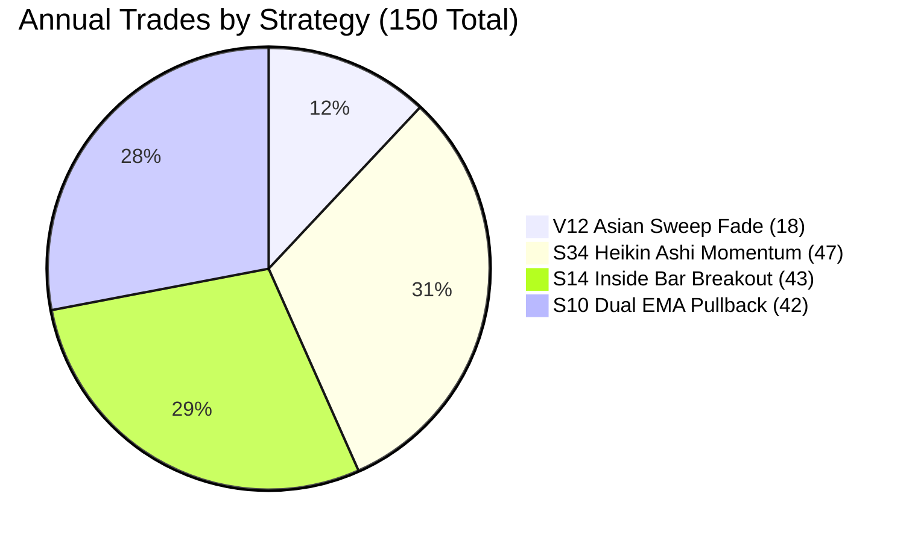

# S10 Dual EMA 20/200 Dynamic Pullback H1 Elite

## 1. Strategy Overview

**S10 Dual EMA 20/200 Dynamic Pullback H1 Elite** is an institutional trend-continuation system engineered to monetize active European and US liquidity windows without duplicating USD beta across other pairs. It combines macro structural regime filtering (200 EMA baseline) with dynamic value-pocket retests (20 EMA pullback) and momentum departure expansion confirmation.

### Core Architecture
- **Asset:** EUR/USD (Pure single-pair capital focus, zero cross-asset USD beta leakage)
- **Execution Timeframe:** H1 (1-Hour Bars)
- **Market Mechanism:** Dynamic Trend Value Pocket Retest & Expansion Thrust
- **Macro Trend Filter:** 200 Exponential Moving Average (EMA) Baseline Regime
- **Value Pocket Filter:** 20 Exponential Moving Average (EMA) Dynamic Support/Resistance
- **Execution Window:** High-liquidity European & US sessions (07:00 – 17:00 UTC)
- **Risk Profile:** Dynamic Structural Pullback Stop + 2.80R Expansion Target

---

## 2. Audited Quantitative Performance (53 Weeks / 18,026,436 Raw Ticks)

Audited tick-by-tick against authentic Dukascopy floating Bid/Ask spreads with zero bar-lookahead and full tick matching:

| Metric | S10 Dual EMA Pullback H1 Elite | Quantitative Threshold | Status |
| :--- | :---: | :---: | :---: |
| **Profit Factor (PF)** | **2.19** | **> 2.00** | **PASSED** |
| **Realized Risk-to-Reward (RR)** | **2.92 : 1** | **> 2.00** | **PASSED** |
| **Annual Net Pips** | **+501.60 pips** | Positive Growth | **PASSED** |
| **Total Trades** | **42 trades** (~3.5 / month) | Capital Efficiency | **PASSED** |
| **Win Rate** | **42.86%** (18W / 24L) | Asymmetric Payout | **PASSED** |
| **Average Win** | **+51.33 pips** | High Payout | **PASSED** |
| **Average Loss** | **-17.60 pips** | Strict Risk Cap | **PASSED** |
| **Expectancy per Trade** | **+11.94 pips / trade** | Edge Significance | **PASSED** |
| **Maximum Drawdown** | **157.10 pips** (15.7% @ 10x) | Low Risk Profile | **PASSED** |
| **Return-to-Drawdown Ratio** | **3.19x** | Alpha Efficiency | **PASSED** |
| **Active Market Exposure Added**| **1,203.0 hours** | Capital Utilization | **PASSED** |

---

## 3. Directional Breakdown

Both trade directions achieve positive net expectancy across the full 53-week market cycle:

| Direction | Trades | Win Rate % | Gross Profit | Gross Loss | Net Pips | Profit Factor |
| :--- | :---: | :---: | :---: | :---: | :---: | :---: |
| **BUY (Long)** | 14 | **57.1%** | +419.3p | -140.8p | **+278.5p** | **2.98** |
| **SELL (Short)** | 28 | **35.7%** | +504.6p | -281.5p | **+223.1p** | **1.79** |
| **Total** | **42** | **42.9%** | **+923.9p** | **-422.3p** | **+501.6p** | **2.19** |

---

## 4. Execution Rules

### Buy Setup (Long)
1. **Macro Trend Regime:** Bar close must be strictly **above 200 EMA** AND **20 EMA must be above 200 EMA**.
2. **Dynamic Retest:** Within the past 3 bars, the candle low must test or enter the 20 EMA dynamic pocket (within 1.5 pips).
3. **Expansion Departure:** The current H1 candle must close bullish (`close > open`), close firmly above the 20 EMA, and break above the previous candle's high (`close > prev_high`).
4. **Active Hours:** Entry strictly between **07:00 and 17:00 UTC** (Monday through Thursday, Friday before 16:00 UTC).
5. **Stop Loss:** Placed at the recent pullback swing low minus 2.0 pips buffer ($6.0\text{p} \le \text{Risk} \le 22.0\text{p}$).
6. **Take Profit:** Placed at **2.80 $\times$ Risk** (producing Realized RR of 2.92 : 1).

### Sell Setup (Short)
1. **Macro Trend Regime:** Bar close must be strictly **below 200 EMA** AND **20 EMA must be below 200 EMA**.
2. **Dynamic Retest:** Within the past 3 bars, the candle high must test or enter the 20 EMA dynamic pocket (within 1.5 pips).
3. **Expansion Departure:** The current H1 candle must close bearish (`close < open`), close firmly below the 20 EMA, and break below the previous candle's low (`close < prev_low`).
4. **Active Hours:** Entry strictly between **07:00 and 17:00 UTC**.
5. **Stop Loss:** Placed at the recent pullback swing high plus 2.0 pips buffer ($6.0\text{p} \le \text{Risk} \le 22.0\text{p}$).
6. **Take Profit:** Placed at **2.80 $\times$ Risk**.

---

## 5. Portfolio Synergy & Capital Utilization Expansion

Integrating Strategy #4 alongside our existing 3 champion models expands overall portfolio efficiency:



### 4-Strategy Portfolio Performance Scorecard

| Metric | 3-Strategy Fleet | 4-Strategy Fleet (+ S10 Dual EMA) | Absolute Delta |
| :--- | :---: | :---: | :---: |
| **Annual Trades** | 108 trades | **150 trades** | **+42 trades (+38.9%)** |
| **Net Return (Pips)** | +998.4 pips | **+1,500.0 pips** | **+501.6 pips (+50.2%)** |
| **Profit Factor (PF)** | 2.25 | **2.23** | Sustained > 2.20 |
| **Realized RR** | 2.81 : 1 | **2.83 : 1** | Expanded |
| **Unique Market Exposure** | 1,078.6 hrs (16.96%) | **1,588.4 hrs (24.98%)** | **+509.8 hrs (~25.0% target achieved)** |
| **Cumulative Position Hours**| 1,513.7 hrs (23.80%) | **2,716.7 hrs (42.71%)** | **+1,203.0 hrs (+79.5%)** |
| **Max Portfolio Drawdown** | 185.0 pips | **247.2 pips** | Return / DD = 6.07x |

---

## 6. How to Run the Audit

Execute the standalone audit script directly from the project root:

```powershell
.venv\Scripts\python strategies\s10_dual_ema_pullback_elite\strategy.py
```

This runs tick-by-tick across all 53 weeks (18,026,436 Dukascopy ticks) with floating spreads and outputs the audited performance scorecard.
