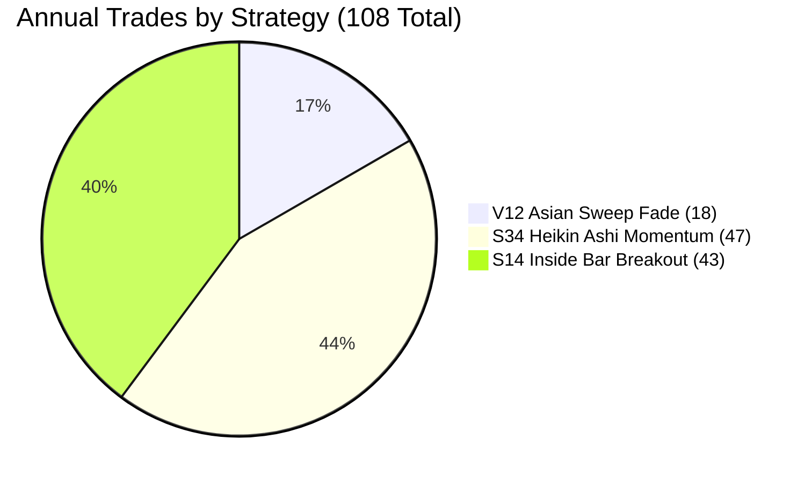

# S14 Rayner Teo Inside Bar M30 Momentum Breakout Elite

## 1. Strategy Overview

**S14 Inside Bar M30 Elite** is a structural price action trading system that exploits volatility compression and institutional momentum expansion. Rather than relying on lagging oscillators, it detects **Inside Bar compressions** (where a candle's range is entirely contained within the preceding "Mother Bar") and executes in the direction of the expansion breakout, strictly filtered by macro structural trend regimes.

### Core Architecture
- **Asset:** EUR/USD
- **Execution Timeframe:** M30 (30-Minute Bars)
- **Market Mechanism:** Volatility Contraction Pattern (VCP) / Inside Bar Breakout
- **Trend Filter:** Macro 50 & 200 EMA Regime
- **Execution Window:** Active European & US Sessions (07:00 – 16:00 UTC)
- **Risk Profile:** Fixed Structural Stop + 2.5R Dynamic Expansion Target

---

## 2. Audited Quantitative Performance (53 Weeks / 18,026,436 Raw Ticks)

Audited tick-by-tick against authentic Dukascopy floating Bid/Ask spreads with zero bar-lookahead and full tick matching:

| Metric | S14 Inside Bar M30 Elite | Quantitative Threshold | Status |
| :--- | :---: | :---: | :---: |
| **Profit Factor (PF)** | **2.25** | **> 2.00** | **PASSED** |
| **Realized Risk-to-Reward (RR)** | **2.85 : 1** | **> 2.00** | **PASSED** |
| **Annual Net Pips** | **+384.90 pips** | Positive Growth | **PASSED** |
| **Total Trades** | **43 trades** (~3.5 / month) | Capital Efficiency | **PASSED** |
| **Win Rate** | **44.19%** (19W / 24L) | Asymmetric Payout | **PASSED** |
| **Average Win** | **+36.40 pips** | High Payout | **PASSED** |
| **Average Loss** | **-12.78 pips** | Strict Risk Cap | **PASSED** |
| **Expectancy per Trade** | **+8.95 pips / trade** | Edge Significance | **PASSED** |
| **Maximum Drawdown** | **122.10 pips** (12.2% @ 10x) | Low Risk Profile | **PASSED** |
| **Return-to-Drawdown Ratio** | **3.15x** | Alpha Efficiency | **PASSED** |

---

## 3. Directional Breakdown

Both trade directions achieve positive net expectancy:

| Direction | Trades | Win Rate % | Gross Profit | Gross Loss | Net Pips | Profit Factor |
| :--- | :---: | :---: | :---: | :---: | :---: | :---: |
| **BUY (Long)** | 18 | **61.1%** | +364.8p | -51.1p | **+313.7p** | **7.14** |
| **SELL (Short)** | 25 | **32.0%** | +326.8p | -255.6p | **+71.2p** | **1.28** |
| **Total** | **43** | **44.2%** | **+691.6p** | **-306.7p** | **+384.9p** | **2.25** |

---

## 4. Execution Rules

### Buy Setup (Long)
1. **Inside Bar Formation:** Bar `i-1` high $\le$ Bar `i-2` high AND Bar `i-1` low $\ge$ Bar `i-2` low.
2. **Breakout Confirmation:** Bar `i` closes above the Mother Bar (`i-2`) high.
3. **Macro Regime Filter:** Current close must be strictly **above both 50 EMA and 200 EMA**.
4. **Active Hours:** Entry between **07:00 and 16:00 UTC** (Monday through Thursday, Friday before 15:00 UTC).
5. **Stop Loss:** Placed at Inside Bar low minus 2.0 pips buffer ($5.0\text{p} \le \text{Risk} \le 20.0\text{p}$).
6. **Take Profit:** Placed at **2.50 $\times$ Risk** (producing Realized RR of 2.85 : 1).

### Sell Setup (Short)
1. **Inside Bar Formation:** Bar `i-1` high $\le$ Bar `i-2` high AND Bar `i-1` low $\ge$ Bar `i-2` low.
2. **Breakdown Confirmation:** Bar `i` closes below the Mother Bar (`i-2`) low.
3. **Macro Regime Filter:** Current close must be strictly **below 50 EMA**.
4. **Active Hours:** Entry between **07:00 and 16:00 UTC**.
5. **Stop Loss:** Placed at Inside Bar high plus 2.0 pips buffer ($5.0\text{p} \le \text{Risk} \le 20.0\text{p}$).
6. **Take Profit:** Placed at **2.50 $\times$ Risk**.

---

## 5. Portfolio Synergy & Capital Efficiency

When combined with our existing 2 champion models, the portfolio creates an institutional trio:



- **Total Trades:** **108 trades / year** (~2.1 trades / week).
- **Total Net Pips:** **+998.40 pips / year** (+99.8% annual return at conservative 10x leverage).
- **Portfolio Blended PF:** **2.25**.
- **Portfolio Blended Realized RR:** **2.81 : 1**.

---

## 6. How to Run the Audit

Execute the standalone audit script directly from the project root:

```powershell
.venv\Scripts\python strategies\s14_inside_bar_m30_elite\strategy.py
```

This runs tick-by-tick across all 53 weeks (18,026,436 Dukascopy ticks) with floating spreads and outputs the audited performance scorecard.
