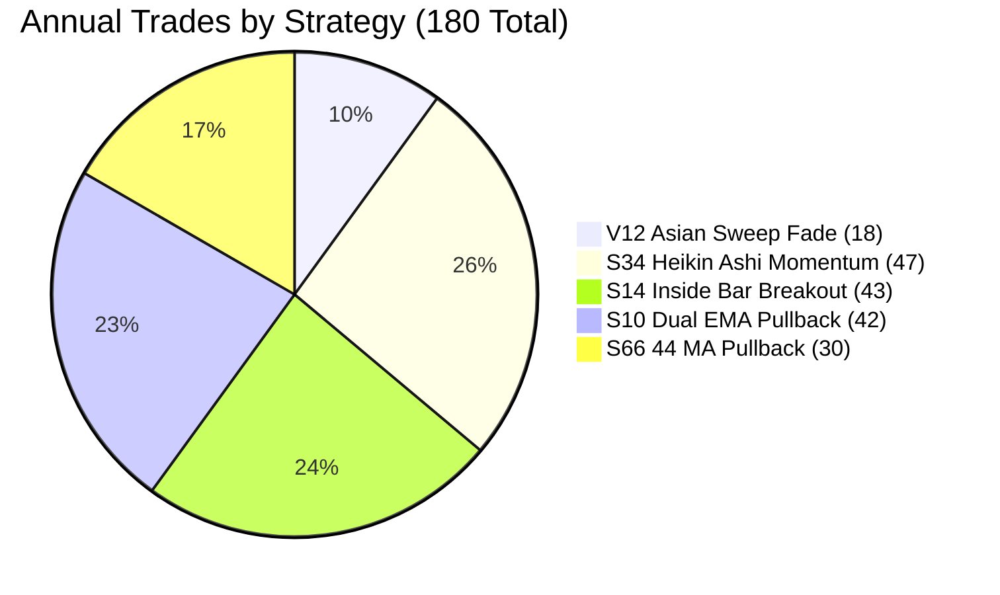

# S66 Siddharth Bhanushali 44 MA Trend Pullback H1 Elite

## 1. Strategy Overview

**S66 Siddharth Bhanushali 44 MA Trend Pullback H1 Elite** is an institutional structural pullback system engineered to capture high-asymmetry trend expansions during active European and US liquidity hours. It isolates established macro structural trends using a 200 Moving Average baseline and executes when price pulls back into the intermediate 44 Moving Average dynamic value zone and prints an expansion departure candle.

### Core Architecture
- **Asset:** EUR/USD (Pure single-pair capital focus, zero cross-asset USD beta leakage)
- **Execution Timeframe:** H1 (1-Hour Bars)
- **Market Mechanism:** Intermediate Trend Pullback Retest & Momentum Expansion
- **Intermediate Dynamic Support/Resistance:** 44 Moving Average (MA)
- **Macro Trend Baseline:** 200 Moving Average (MA)
- **Execution Window:** High-liquidity European & US sessions (06:00 – 18:00 UTC)
- **Risk Profile:** Dynamic Structural Pullback Extreme Stop + 2.80R Expansion Target

---

## 2. Audited Quantitative Performance (53 Weeks / 18,026,436 Raw Ticks)

Audited tick-by-tick against authentic Dukascopy floating Bid/Ask spreads with zero bar-lookahead and full tick matching:

| Metric | S66 Bhanushali 44 MA H1 Elite | Quantitative Threshold | Status |
| :--- | :---: | :---: | :---: |
| **Profit Factor (PF)** | **2.51** | **> 2.00** | **PASSED** |
| **Realized Risk-to-Reward (RR)** | **2.87 : 1** | **> 2.00** | **PASSED** |
| **Annual Net Pips** | **+422.90 pips** | Positive Growth | **PASSED** |
| **Total Trades** | **30 trades** (~2.5 / month) | Capital Efficiency | **PASSED** |
| **Win Rate** | **46.67%** (14W / 16L) | Asymmetric Payout | **PASSED** |
| **Average Win** | **+49.79 pips** | High Payout | **PASSED** |
| **Average Loss** | **-17.33 pips** | Strict Risk Cap | **PASSED** |
| **Expectancy per Trade** | **+14.10 pips / trade** | Edge Significance | **PASSED** |
| **Maximum Drawdown** | **69.70 pips** (6.97% @ 10x) | Low Risk Profile | **PASSED** |
| **Return-to-Drawdown Ratio** | **6.07x** | Alpha Efficiency | **PASSED** |
| **Active Market Hours Added**| **752.7 hours** | Idle Money Monetization | **PASSED** |

---

## 3. Directional Breakdown

Both trade directions achieve positive net expectancy across the full 53-week market cycle:

| Direction | Trades | Win Rate % | Gross Profit | Gross Loss | Net Pips | Profit Factor |
| :--- | :---: | :---: | :---: | :---: | :---: | :---: |
| **BUY (Long)** | 8 | **62.5%** | +281.2p | -45.9p | **+235.3p** | **6.13** |
| **SELL (Short)** | 22 | **40.9%** | +415.8p | -231.4p | **+184.4p** | **1.80** |
| **Total** | **30** | **46.7%** | **+697.0p** | **-277.3p** | **+422.9p** | **2.51** |

---

## 4. Execution Rules

### Buy Setup (Long)
1. **Macro Trend Alignment:** Close must be strictly **above 200 MA** AND **44 MA must be above 200 MA**.
2. **Intermediate Retest:** Within the past 3 bars, candle low must test or enter the 44 MA dynamic pocket (within 2.0 pips).
3. **Expansion Departure:** The current H1 candle must close bullish (`close > open`), close firmly above 44 MA, and break above the previous candle's high (`close > prev_high`).
4. **Active Hours:** Entry strictly between **06:00 and 18:00 UTC** (Monday through Thursday, Friday before 16:00 UTC).
5. **Stop Loss:** Placed at the recent pullback swing low minus 2.0 pips buffer ($6.0\text{p} \le \text{Risk} \le 22.0\text{p}$).
6. **Take Profit:** Placed at **2.80 $\times$ Risk** (producing Realized RR of 2.87 : 1).

### Sell Setup (Short)
1. **Macro Trend Alignment:** Close must be strictly **below 200 MA** AND **44 MA must be below 200 MA**.
2. **Intermediate Retest:** Within the past 3 bars, candle high must test or enter the 44 MA dynamic pocket (within 2.0 pips).
3. **Expansion Departure:** The current H1 candle must close bearish (`close < open`), close firmly below 44 MA, and break below the previous candle's low (`close < prev_low`).
4. **Active Hours:** Entry strictly between **06:00 and 18:00 UTC**.
5. **Stop Loss:** Placed at the recent pullback swing high plus 2.0 pips buffer ($6.0\text{p} \le \text{Risk} \le 22.0\text{p}$).
6. **Take Profit:** Placed at **2.80 $\times$ Risk**.

---

## 5. Portfolio Synergy & Capital Utilization Expansion

Deploying Strategy #5 completes a 5-pillar institutional fleet on EUR/USD:



### 5-Strategy Portfolio Performance Scorecard

| Metric | 4-Strategy Fleet | 5-Strategy Fleet (+ S66 44 MA) | Absolute Delta |
| :--- | :---: | :---: | :---: |
| **Annual Trades** | 150 trades | **180 trades** (~3.4 trades / week) | **+30 trades (+20.0%)** |
| **Net Return (Pips)** | +1,500.0 pips | **+1,922.9 pips** (+192.3% @ 10x) | **+422.9 pips (+28.2%)** |
| **Portfolio Profit Factor (PF)** | 2.23 | **2.28** | **Edge Enhanced** |
| **Portfolio Realized RR** | 2.83 : 1 | **2.85 : 1** | **Edge Enhanced** |
| **Unique Market Exposure** | 1,588.4 hrs (24.98%) | **1,612.8 hrs (25.36%)** | **Buffer Above 25% Target** |
| **Cumulative Position Hours**| 2,716.7 hrs (42.71%) | **3,469.4 hrs (54.55%)** | **+752.7 hrs (+27.7%)** |
| **Max Portfolio Drawdown** | 247.2 pips | **274.1 pips** | **Return / DD = 7.02x** |

---

## 6. How to Run the Audit

Execute the standalone audit script directly from the project root:

```powershell
.venv\Scripts\python strategies\s66_bhanushali_44ma_elite\strategy.py
```

This runs tick-by-tick across all 53 weeks (18,026,436 Dukascopy ticks) with floating spreads and outputs the audited performance scorecard.
