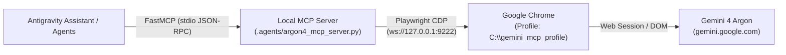

# Gemini 4 Argon MCP Server Bridge Reference Guide

This document provides complete architectural documentation, operational procedures, startup commands, and troubleshooting workflows for the local **Argon 4 MCP Server Bridge** (`argon4-bridge`).

---

## 1. Architecture Overview

The `argon4-bridge` allows the Antigravity assistant and custom agents to programmatically consult **Gemini 4 Argon** as a senior quantitative researcher and technical manager using an active Google session running in Google Chrome.



### Key Components

1. **Client Interface**: FastMCP server tool `ask_argon4(prompt: str, code_context: str = "") -> str`.
2. **Concurrency Control**: Global `asyncio.Lock()` guarantees sequential, orderly message submissions to avoid UI race conditions.
3. **Self-Healing Supervisor (`ensure_chrome_debug`)**: Automatically tests endpoint `http://127.0.0.1:9222/json/version`. If Chrome is offline, it spawns a background headless Chrome process using the persistent user profile `C:\gemini_mcp_profile`.
4. **Non-Destructive Session Management**: Calls `await browser.close()` in Playwright only to detach the CDP connection. The user's underlying Chrome process and Gemini tab remain open and intact across calls.
5. **Session & Auth Guard**: Automatically detects redirects to `accounts.google.com` or missing prompt inputs and alerts the user immediately with actionable instructions.

---

## 2. One-Time Login / Re-Authentication (Visible Window)

Before using the bridge or whenever your Google session expires, launch Chrome in visible mode to log in and select **Gemini 4 Argon**:

### PowerShell Command (Visible Window)

Run this command in Windows PowerShell:

```powershell
& "C:\Program Files\Google\Chrome\Application\chrome.exe" --remote-debugging-port=9222 --user-data-dir="C:\gemini_mcp_profile" https://gemini.google.com
```

### Steps to Complete in the Browser:
1. Log into your Google account associated with Gemini 4 Argon.
2. In the Gemini web UI model selector (top dropdown), select **Gemini 4 Argon** (or your preferred frontier model).
3. Verify that the chat interface loads and the prompt box (`Ask Gemini` / `div[role="textbox"]`) is responsive.
4. **Leave this Chrome window open** (or minimize it). The MCP server will attach directly via CDP port `9222`.

---

## 3. Window Visibility & Anti-Bot Protection

> [!IMPORTANT]
> **Keep the Chrome Window Open (or Minimized):**
> Google's web application (`gemini.google.com`) strictly monitors automated headless traffic (`--headless=new`) and will trigger an enterprise anti-bot challenge (`google.com/sorry/index`) if launched in headless mode. 
> To prevent anti-bot challenges and maintain continuous session viability, Chrome should always run in normal (visible/minimized) mode with remote debugging enabled.

---

## 4. MCP Server Registration & Configuration

The bridge is registered in both `.agents/mcp_config.json` and `mcp_config.json`:

```json
{
  "mcpServers": {
    "argon4-bridge": {
      "command": "D:/PROJECT/TRD/MODELS GENERATIONS/BACKTEST/.venv/Scripts/python.exe",
      "args": [
        "D:/PROJECT/TRD/MODELS GENERATIONS/BACKTEST/.agents/argon4_mcp_server.py"
      ],
      "timeoutSeconds": 300
    }
  }
}
```

- **Runtime**: `D:/PROJECT/TRD/MODELS GENERATIONS/BACKTEST/.venv/Scripts/python.exe`
- **Script**: `D:/PROJECT/TRD/MODELS GENERATIONS/BACKTEST/.agents/argon4_mcp_server.py`
- **Execution Timeout**: 300 seconds (allowing deep chain-of-thought generation).

---

## 5. Troubleshooting & Maintenance

### 1. Verify Chrome CDP Status
Check if Chrome is actively listening on port 9222:

```powershell
Invoke-RestMethod -Uri http://127.0.0.1:9222/json/version
```

Expected output:
```text
Browser              : Chrome/157.x.x.x
Protocol-Version     : 1.3
User-Agent           : Mozilla/5.0 ...
webSocketDebuggerUrl : ws://127.0.0.1:9222/devtools/browser/...
```

### 2. Inspect Open Tabs
Inspect which tabs are currently loaded inside the debugging profile:

```powershell
(Invoke-RestMethod -Uri http://127.0.0.1:9222/json/list) | Select-Object id, title, url
```

### 3. Kill Stray / Locked Chrome Processes
If Chrome hangs, port 9222 is unresponsive, or the profile `C:\gemini_mcp_profile` is locked by a zombie process, terminate Chrome processes using:

```powershell
Get-Process chrome -ErrorAction SilentlyContinue | Stop-Process -Force
```

Then relaunch via the visible command in Section 2.

### 4. DOM Selectors in `.agents/argon4_mcp_server.py`
If Google updates the Gemini web interface in the future, check and update these three selectors in `.agents/argon4_mcp_server.py`:

| Role | Current Selector | Description |
|---|---|---|
| **Input Textbox** | `div[role="textbox"]` | Main message input field |
| **Stop Button** | `button[aria-label*="Stop" i]` | Appears during generation; disappears when finished |
| **Response Container** | `model-response, .model-response-text, message-content` | Element containing the model's textual output |

---

## 6. Verification Checklist

- [x] Python dependencies installed in `.venv`: `fastmcp`, `playwright`, and Chromium binaries.
- [x] Server script created: `.agents/argon4_mcp_server.py` with `ensure_chrome_debug()` self-healing auto-launch.
- [x] MCP configuration registered: `.agents/mcp_config.json` with forward slashes and 300s timeout.
- [x] Documentation saved: `docs/ARGON4_MCP_BRIDGE.md`.

