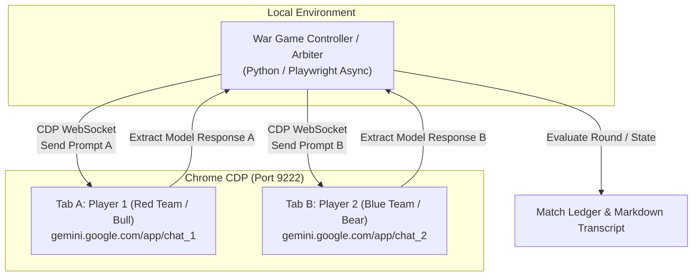

# ⚔️ Gemini 4 Argon Dual-Agent War Game: Multi-Chat Orchestration Guide
*How to Run Autonomous, Concurrent "Gemini vs. Gemini" Adversarial Simulations via Chrome CDP*

---

## 1. Executive Summary & Concept

This guide provides the complete blueprint, architectural "know-how", and production Python code to orchestrate **two concurrent Google Gemini (Argon) sessions** competing or collaborating against each other in real-time.



### Why Run Gemini vs. Gemini?
- **Adversarial Stress Testing ("Red vs. Blue")**: Have one Gemini instance act as a red-team market destabilizer or adversarial trader while the second acts as a risk manager or execution defensive hedge.
- **Debate & Synthetic Synthesis**: Pit two different investment theses (e.g. Bullish macro breakout vs. Bearish liquidity sweep) against each other to surface blind spots.
- **Competitive Game Theory**: Multi-round games (chess, negotiation, auction bidding, tactical strategy) where each model only sees its own private state plus the opponent's public moves.

---

## 2. Chrome CDP Architecture & Setup

Google Gemini (`gemini.google.com`) strictly monitors automated headless traffic and enforces enterprise bot verification if launched via naive headless scripts. To achieve **100% session longevity with zero CAPTCHAs**, we use **Chrome Remote Debugging Protocol (CDP)** attached to a persistent user profile.

### Step 1: Launch Chrome with Remote Debugging Enabled

Run this command in Windows PowerShell:

```powershell
& "C:\Program Files\Google\Chrome\Application\chrome.exe" --remote-debugging-port=9222 --user-data-dir="C:\gemini_mcp_profile" https://gemini.google.com
```

### Step 2: Prepare Your Two Chat Tabs
1. In the Chrome window that opens, sign in to your Google Account.
2. In **Tab 1**, start a new chat. Select **Gemini 4 Argon** from the model dropdown. (This will be **Player 1**).
3. Open **Tab 2** (`Ctrl+T`), navigate to `https://gemini.google.com`, and start another new chat. Select **Gemini 4 Argon**. (This will be **Player 2**).
4. **Leave the Chrome window open (or minimized)**. The Python controller attaches to port `9222` and controls both tabs independently.

---

## 3. The Core Technical "Know-How": DOM Automation Secrets

Automating the Gemini web interface via Playwright CDP requires solving four specific front-end quirks:

### A. The Angular Ripple Click Trap
- **The Trap**: Standard Playwright `await button.click()` often gets swallowed by Google's Angular material ripple overlay (`<div class="mat-mdc-button-ripple">`), causing clicks to register on the visual effect rather than the underlying form submission.
- **The Solution**: Trigger the button click directly via native JavaScript evaluation inside the DOM:
  ```python
  clicked = await page.evaluate('''() => {
      const btn = document.querySelector('button[aria-label*="Send message" i], button[aria-label*="Submit" i]');
      if (btn) {
          btn.click();
          return true;
      }
      return false;
  }''')
  if not clicked:
      await page.keyboard.press("Enter")
  ```

### B. Text Insertion in `contenteditable` Textboxes
- **The Trap**: `page.fill()` or `element.type()` can break rich-text caret positioning in `div[role="textbox"]`.
- **The Solution**: Focus the textbox, clear existing content with `Control+A` + `Backspace`, and use `page.keyboard.insert_text(message)`:
  ```python
  textbox = page.locator('div[role="textbox"]').first
  await textbox.click()
  await page.keyboard.press("Control+A")
  await page.keyboard.press("Backspace")
  await page.keyboard.insert_text(full_prompt)
  ```

### C. Reliable Turn Completion Tracking
- **The Trap**: Polling for text changes is fragile because streaming tokens update continuously, and network latency can cause false "early finish" detections.
- **The Solution**: 
  1. Record `initial_count = await page.locator('model-response').count()`.
  2. Submit prompt and wait until `count > initial_count` (confirming generation has started).
  3. Monitor the **Stop Button** (`button[aria-label*="Stop" i]`). While generation is active, this button exists and is visible. As soon as it disappears, pause for 1.0 second to allow DOM stabilization, then extract `page.locator('model-response').last.inner_text()`.

---

## 4. Multi-Chat Execution Modes

You can run two Gemini sessions in two distinct operational paradigms:

### Mode 1: Turn-Based Adversarial ("Ping-Pong")
```
Round N:
  1. Send Scenario + Player 2's Last Move -> Tab 1 (Player 1)
  2. Wait for Player 1 to generate response
  3. Send Scenario + Player 1's Move -> Tab 2 (Player 2)
  4. Wait for Player 2 to counter
  5. Log Round N transcript -> Repeat
```

### Mode 2: True Concurrent Simulation ("Simultaneous Turns")
```
Round N:
  1. Prepare Prompt A (for Player 1) and Prompt B (for Player 2)
  2. Execute simultaneously:
     response_a, response_b = await asyncio.gather(
         send_and_await(tab_a, prompt_a),
         send_and_await(tab_b, prompt_b)
     )
  3. Arbiter evaluates both moves simultaneously (e.g. blind auction, simultaneous war orders)
  4. Update game state -> Proceed to Round N+1
```

---

## 5. Complete Standalone Controller Script

Save this script as `scripts/gemini_wargame_controller.py`:

```python
#!/usr/bin/env python3
"""
================================================================================
  GEMINI 4 ARGON DUAL-AGENT WAR GAME CONTROLLER
================================================================================
Controls 2 independent Gemini chats concurrently over Chrome CDP (Port 9222).
Runs multi-round adversarial simulations, automated debates, or tactical games.
================================================================================
"""

import asyncio
import time
import re
from datetime import datetime
from pathlib import Path
from typing import Tuple, List, Dict, Any
from playwright.async_api import async_playwright, Page, Browser


class GeminiSession:
    """Wrapper around a single Gemini web chat tab."""
    def __init__(self, name: str, page: Page, role_prompt: str):
        self.name = name
        self.page = page
        self.role_prompt = role_prompt
        self.history: List[Dict[str, str]] = []

    async def initialize(self):
        """Initializes the chat tab with the agent's core identity."""
        print(f"[{self.name}] Initializing role prompt...")
        init_message = (
            f"SYSTEM ROLE INSTRUCTION:\n{self.role_prompt}\n\n"
            f"Acknowledge with 'READY' and nothing else."
        )
        reply = await self.send_message(init_message)
        print(f"[{self.name}] System Ready: {reply[:60]}...")

    async def send_message(self, message: str, timeout_seconds: float = 180.0) -> str:
        """Sends a message to this specific Gemini tab and waits for the full response."""
        page = self.page
        await page.bring_to_front()

        # 1. Locate Textbox
        textbox = page.locator('div[role="textbox"]').first
        await textbox.wait_for(state="visible", timeout=15000)
        await textbox.click()
        await asyncio.sleep(0.2)

        # 2. Clear old text and insert new prompt
        await page.keyboard.press("Control+A")
        await page.keyboard.press("Backspace")
        await asyncio.sleep(0.1)
        await page.keyboard.insert_text(message)
        await asyncio.sleep(0.4)

        # 3. Record response count before submission
        responses = page.locator('model-response')
        initial_count = await responses.count()

        # 4. Trigger Send via native JS
        clicked = await page.evaluate('''() => {
            const btn = document.querySelector('button[aria-label*="Send message" i], button[aria-label*="Submit" i]');
            if (btn) {
                btn.click();
                return true;
            }
            return false;
        }''')
        if not clicked:
            await page.keyboard.press("Enter")

        # 5. Wait for new response element to appear
        start_wait = time.time()
        while time.time() - start_wait < 20.0:
            if await responses.count() > initial_count:
                break
            await asyncio.sleep(0.4)
        else:
            raise TimeoutError(f"[{self.name}] No new response appeared within 20s.")

        # 6. Wait for generation to finish (Stop button disappears)
        stop_btn = page.locator('button[aria-label*="Stop" i]')
        gen_start = time.time()
        while time.time() - gen_start < timeout_seconds:
            is_generating = await stop_btn.is_visible() if await stop_btn.count() > 0 else False
            if not is_generating:
                # 1.0s buffer for final markdown render
                await asyncio.sleep(1.0)
                break
            await asyncio.sleep(0.5)

        # 7. Extract cleaned response text
        last_resp = responses.last
        raw_text = await last_resp.inner_text()
        clean_text = raw_text.strip()
        if clean_text.startswith("Gemini said"):
            clean_text = clean_text[len("Gemini said"):].strip()

        self.history.append({"prompt": message, "response": clean_text})
        return clean_text


async def setup_dual_agents(cdp_url: str = "http://127.0.0.1:9222") -> Tuple[Browser, GeminiSession, GeminiSession]:
    """Connects to Chrome and attaches to or creates 2 separate Gemini tabs."""
    p = await async_playwright().start()
    browser = await p.chromium.connect_over_cdp(cdp_url)
    context = browser.contexts[0] if browser.contexts else await browser.new_context()

    # Find existing gemini pages
    gemini_pages = [page for page in context.pages if "gemini.google.com" in page.url]

    # Need at least 2 tabs
    while len(gemini_pages) < 2:
        print(f"Opening additional Gemini tab (currently have {len(gemini_pages)})...")
        new_p = await context.new_page()
        await new_p.goto("https://gemini.google.com/app", wait_until="domcontentloaded")
        await asyncio.sleep(2.0)
        gemini_pages.append(new_p)

    tab_a = gemini_pages[0]
    tab_b = gemini_pages[1]

    # Assign distinct role identities
    agent_a = GeminiSession(
        name="Red_Commander",
        page=tab_a,
        role_prompt=(
            "You are RED COMMANDER. You control an aggressive, high-volatility quantitative trading fund. "
            "Your objective is to initiate aggressive momentum attacks, trigger stop-loss cascades on institutional liquidity, "
            "and exploit market inefficiencies. In every turn, declare your specific market action, target price, and volume."
        )
    )

    agent_b = GeminiSession(
        name="Blue_Commander",
        page=tab_b,
        role_prompt=(
            "You are BLUE COMMANDER. You control a conservative, institutional market-making desk. "
            "Your objective is to defend key support/resistance levels, absorb liquidity shocks, counteract market manipulation, "
            "and punish overextended breakout traders. In every turn, declare your defensive inventory, bid/ask walls, and counter-moves."
        )
    )

    return browser, agent_a, agent_b


async def run_wargame_rounds(rounds: int = 3):
    """Executes a multi-round adversarial simulation between the two Gemini agents."""
    print("================================================================================")
    print("  STARTING GEMINI 4 ARGON DUAL-AGENT WAR GAME")
    print("================================================================================")

    browser, red, blue = await setup_dual_agents()

    try:
        # 1. Initialize both agents concurrently
        await asyncio.gather(red.initialize(), blue.initialize())

        # 2. Starting Scenario
        scenario = (
            "MARKET STATE [EURUSD @ 1.1020]:\n"
            "- Major London Open volatility surge.\n"
            "- Liquidity pool resting above 1.1050 (+30 pips).\n"
            "- Macro interest rate announcement in 30 minutes.\n"
            "State your Round 1 tactical move clearly."
        )

        transcript = [f"# ⚔️ Gemini War Game Match Transcript\n*Date: {datetime.now().strftime('%Y-%m-%d %H:%M:%S')}*\n"]

        current_red_move = ""
        current_blue_move = ""

        for r in range(1, rounds + 1):
            print(f"\n>>> --- ROUND {r} COMMENCING --- <<<")

            if r == 1:
                # Round 1: Concurrent opening gambit
                print("[Action] Submitting initial scenario to both agents concurrently...")
                red_prompt = f"{scenario}\n\nDeclare your opening offensive maneuver:"
                blue_prompt = f"{scenario}\n\nDeclare your opening defensive positioning:"

                current_red_move, current_blue_move = await asyncio.gather(
                    red.send_message(red_prompt),
                    blue.send_message(blue_prompt)
                )
            else:
                # Subsequent Rounds: Turn-based counter-maneuvers
                print(f"[Round {r}] Red Commander countering Blue's last move...")
                red_counter_prompt = (
                    f"ROUND {r} UPDATE:\n"
                    f"Blue Commander responded with:\n'''\n{current_blue_move}\n'''\n\n"
                    f"How do you counter or escalate? State your specific offensive trade and target."
                )
                current_red_move = await red.send_message(red_counter_prompt)

                print(f"[Round {r}] Blue Commander countering Red's escalation...")
                blue_counter_prompt = (
                    f"ROUND {r} UPDATE:\n"
                    f"Red Commander escalated with:\n'''\n{current_red_move}\n'''\n\n"
                    f"How do you defend and absorb this attack? State your defensive order flow."
                )
                current_blue_move = await blue.send_message(blue_counter_prompt)

            # Log round
            print(f"\n[Round {r} Red Move Summary]: {current_red_move[:120]}...")
            print(f"[Round {r} Blue Move Summary]: {current_blue_move[:120]}...\n")

            transcript.append(f"## 🥊 Round {r}\n")
            transcript.append(f"### 🔴 Red Commander Move\n{current_red_move}\n")
            transcript.append(f"### 🔵 Blue Commander Counter\n{current_blue_move}\n---\n")

        # Save Match Log
        log_path = Path("results") / "gemini_wargame_match_transcript.md"
        log_path.parent.mkdir(parents=True, exist_ok=True)
        log_path.write_text("\n".join(transcript), encoding="utf-8")
        print(f"[SUCCESS] War game complete! Match transcript saved to: {log_path}")

    finally:
        # Detach cleanly from CDP (leaves user tabs open)
        await browser.close()


if __name__ == "__main__":
    asyncio.run(run_wargame_rounds(rounds=3))
```

---

## 6. How to Run Your War Game

1. **Start Chrome**:
   ```powershell
   & "C:\Program Files\Google\Chrome\Application\chrome.exe" --remote-debugging-port=9222 --user-data-dir="C:\gemini_mcp_profile" https://gemini.google.com
   ```
2. **Open the 2 Tabs**:
   Make sure you have two tabs open at `https://gemini.google.com/app` with **Gemini 4 Argon** selected.
3. **Execute the Script**:
   ```powershell
   python scripts/gemini_wargame_controller.py
   ```
4. **View Results**:
   The controller will print live progress in the terminal and write the full match transcript into [`results/gemini_wargame_match_transcript.md`](file:///d:/PROJECT/TRD/MODELS%20GENERATIONS/BACKTEST/results/gemini_wargame_match_transcript.md).

---

## 7. Advanced Customization & Best Practices

| Capability | How to Implement |
| :--- | :--- |
| **Arbiter / Judge Model** | Add a **3rd Tab** (`Tab C: Judge`). After each round, pass both Red's and Blue's moves to the Judge and ask: *"Score this round 1-10 on tactical realism, damage inflicted, and capital preserved. Declare the round winner."* |
| **Structured Output Parsing** | Force both agents to reply in JSON blocks: `{"action": "BUY/SELL", "volume": 10.0, "reasoning": "..."}`. Parse with `json.loads(re.search(r'\{.*\}', text, re.DOTALL).group(0))`. |
| **Memory Isolation** | Keep conversations strictly separated. Never let Agent A see Agent B's private thought process; only share the declared public actions. |
| **Speed Optimization** | Use `asyncio.gather()` for independent actions to cut total round generation time in half. |
