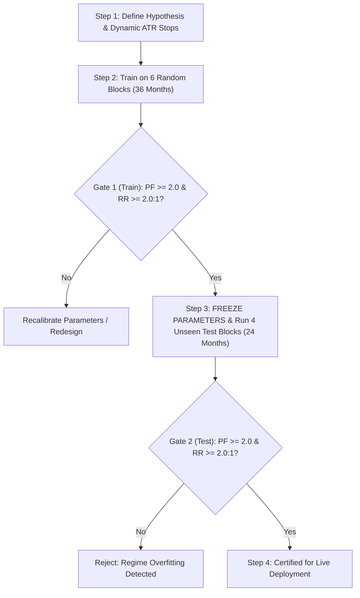

# Standard Operating Procedure (SOP): 10-Block (6-Month Unit) Validation Protocol

**Document ID:** `SOP-TRD-VAL-5Y-002`  
**Supercedes:** `SOP-TRD-VAL-5Y-001`  
**Effective Date:** `October 2026`  
**Applies To:** All Quantitative Trading Strategies, Machine Learning Models, and Algorithmic Fleets for EUR/USD  
**Engine:** High-Speed Tick Engine (`tick_engine`)

---

## 1. Executive Mandate & Purpose

To prevent overfitting, curve-fitting, lookahead bias, and **macro regime clustering**, all strategy development and evaluation must strictly adhere to the **10-Block (6-Month Unit) Cross-Validation Architecture**.

The complete 5-year tick dataset (**60 months / 262 weeks / 123,223,663 authentic ticks**) is divided into **10 discrete 6-Month Units (Blocks B01 to B10)**:
- **6 Random Units** ($6 \times 6 = 36\text{ months} = 3\text{ Years}$) are selected for **In-Sample Training & Model Calibration**.
- **4 Remaining Units** ($4 \times 6 = 24\text{ months} = 2\text{ Years}$) are reserved for **Strict Unseen Out-of-Sample Testing**.

```
┌─────────────────────────────────────────────────────────────────────────────────────────────────────────┐
│                                 5-YEAR HIGH-PRECISION TICK DATASET                                      │
│                            Total: 60 Months | 262 Weeks | 123,223,663 Ticks                            │
├─────────────────────────────────────────────────────────────────────────────────────────────────────────┤
│                                10 DISCRETE 6-MONTH UNITS (BLOCKS B01 – B10)                             │
│   [B01]       [B02]       [B03]       [B04]       [B05]       [B06]       [B07]       [B08]       [B09]       [B10]     │
│   6 Mos       6 Mos       6 Mos       6 Mos       6 Mos       6 Mos       6 Mos       6 Mos       6 Mos       6 Mos     │
├────────────────────────────────────────────────────┬────────────────────────────────────────────────────┤
│         6 RANDOM UNITS (36 MONTHS / 3 YEARS)       │         4 RANDOM UNITS (24 MONTHS / 2 YEARS)       │
│                 IN-SAMPLE TRAINING                 │             UNSEEN OUT-OF-SAMPLE TESTING           │
├────────────────────────────────────────────────────┼────────────────────────────────────────────────────┤
│  • Parameter discovery & dynamic ATR tuning        │  • STRICT BLIND FORWARD TEST                       │
│  • Multi-timeframe indicator calibration           │  • COMPLETE PARAMETER FREEZE                       │
│  • Feature selection & threshold optimization      │  • Multi-regime robustness verification            │
│  • Target: Profit Factor >= 2.0 & RR >= 2.0 : 1    │  • Target: Profit Factor >= 2.0 & RR >= 2.0 : 1    │
└────────────────────────────────────────────────────┴────────────────────────────────────────────────────┘
```

---

## 2. Why the 6-Month Unit Block Architecture is Mandatory

In algorithmic trading, taking a contiguous 3-year block followed by a contiguous 2-year block introduces **macro regime bias**:
- In a contiguous split, the model trains exclusively on the 2021–2024 aggressive inflation/rate-hike bear market and is tested exclusively on the 2024–2026 rate-cut cycle.
- By breaking the 5 years into **10 discrete 6-month units** and randomly sampling **6 for training and 4 for testing**:
  1. Both the training and test sets encounter diverse volatility regimes (high ATR shock cycles, balanced trending cycles, and low volatility summer consolidations).
  2. The model cannot overfit to a specific two-year window.
  3. The out-of-sample test provides a true multi-regime stress test across historical shocks and modern liquidity.

---

## 3. Catalog of the 10 Discrete 6-Month Units

Each unit represents approximately 26 weeks (~6 calendar months) of institutional tick data:

| Unit ID | Week Range | Calendar Span | Tick Count | Macroeconomic & Market Regime |
| :---: | :---: | :---: | :---: | :--- |
| **B01** | `W001 – W026` | 2021-10-01 → 2022-03-25 | 9,197,603 | Post-COVID recovery; initial Federal Reserve tapering onset. |
| **B02** | `W027 – W052` | 2022-03-28 → 2022-09-23 | 16,730,617 | Ukraine War shock; historical EUR crash down to parity (`0.9535`). Extreme trend. |
| **B03** | `W053 – W078` | 2022-09-26 → 2023-03-24 | 21,306,649 | Peak ECB/Fed aggressive tightening (+75 bps hikes); peak daily ATR volatility. |
| **B04** | `W079 – W104` | 2023-03-27 → 2023-09-22 | 11,915,028 | US Regional Banking crisis (SVB); consolidation and sharp retests. |
| **B05** | `W105 – W130` | 2023-09-25 → 2024-03-22 | 11,594,685 | Peak interest rates plateau; range-bound mean-reversion market. |
| **B06** | `W131 – W156` | 2024-03-25 → 2024-09-20 | 8,925,193 | Global disinflation cycle; transition from rate hikes toward cuts. |
| **B07** | `W157 – W182` | 2024-09-23 → 2025-03-21 | 12,663,910 | Global easing cycle commences (Fed/ECB rate cuts); renewed trend momentum. |
| **B08** | `W183 – W208` | 2025-03-24 → 2025-09-19 | 12,612,686 | Balanced institutional liquidity; clean London/NY session expansions. |
| **B09** | `W209 – W235` | 2025-09-22 → 2026-03-27 | 9,595,360 | Stable multi-timeframe pullback trends; reliable Asian session boundaries. |
| **B10** | `W236 – W262` | 2026-03-30 → 2026-10-01 | 8,681,932 | Modern liquidity regime; high-precision algorithmic execution. |

---

## 4. Sampling Protocol & Deterministic Seeding

To ensure 100% reproducibility across teams and systems, randomized sampling uses an explicit pseudo-random seed:

### **Standard Benchmark Seed (`--seed 42`):**
- **Training Units (6 Blocks / 36 Months / 67.8M Ticks):**  
  `B01, B02, B05, B06, B07, B10` (Weeks: `1-52`, `105-182`, `236-262`)
- **Testing Units (4 Blocks / 24 Months / 55.4M Ticks):**  
  `B03, B04, B08, B09` (Weeks: `53-104`, `183-235`)

### **Alternate Shuffled Splits:**
- Seed `100`: Train = `B02, B03, B04, B07, B08, B09` | Test = `B01, B05, B06, B10`
- Seed `2026`: Train = `B02, B05, B06, B08, B09, B10` | Test = `B01, B03, B04, B07`

---

## 5. Performance Quality Gates (Target: PF > 2.0 & RR > 2.0 : 1)

Every strategy candidate must satisfy both quantitative gates under the 6/4 randomized split:



### **Gate 1: In-Sample Training Gate (6 Random Blocks / 36 Months)**
- **Sample Size:** $\ge 120$ completed trades across the 6 blocks
- **Profit Factor (PF):** **$\ge 2.00$**
- **Realized Risk-to-Reward (RR):** **$\ge 2.00 : 1$** (Average Win Pips $\ge 2.0 \times$ Average Loss Pips)
- **Net Pips:** $> +500.0$ pips
- **Max Drawdown:** $\le 350.0$ pips

### **Gate 2: Out-of-Sample Survival Gate (4 Unseen Blocks / 24 Months)**
- **Parameter Freeze:** Zero parameter changes allowed.
- **Profit Factor (PF):** **$\ge 2.00$**
- **Realized Risk-to-Reward (RR):** **$\ge 2.00 : 1$**
- **Net Pips:** $> +300.0$ pips on completely unseen data
- **Drawdown Expansion Factor:** $\text{MaxDD}_{\text{Test}} \le 1.25 \times \text{MaxDD}_{\text{Train}}$
- **Profitable Blocks:** At least 3 out of 4 unseen 6-month blocks must be individually profitable.

---

## 6. CLI Command Reference

The test engine natively executes the 10-block randomized sampling architecture:

| Operation | CLI Command |
| :--- | :--- |
| **Run 6 Random Train Blocks (Seed 42)** | `python run_backtest.py --strategy <NAME> --random-blocks --split train --seed 42` |
| **Run 4 Unseen Test Blocks (Seed 42)** | `python run_backtest.py --strategy <NAME> --random-blocks --split test --seed 42` |
| **Run Arbitrary Specific Blocks** | `python run_backtest.py --strategy <NAME> --blocks 1,3,5,7,9` |
| **Run Top 15 Fleet on 6 Train Blocks** | `python run_backtest.py --top15 --random-blocks --split train --seed 42` |
| **Run Top 15 Fleet on 4 Test Blocks** | `python run_backtest.py --top15 --random-blocks --split test --seed 42` |
| **Run Full 5-Year Dataset (All 10 Blocks)** | `python run_backtest.py --strategy <NAME> --split all` |
