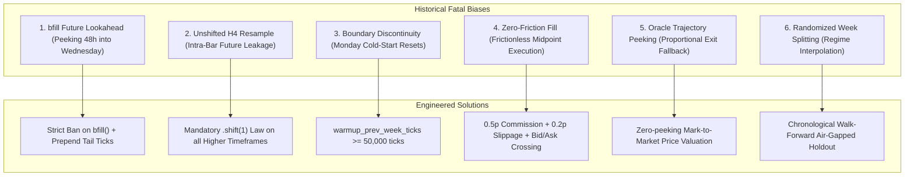

# Institutional Backtesting Methodology: Biases, Forensic Case Studies, and Solutions Manual

**Repository:** `TRD/MODELS GENERATIONS/BACKTEST`  
**Classification:** Institutional Standard Operating Procedure (SOP)  
**Status:** Mandatory Engineering Standard  

---

## 1. Executive Overview & The Post-Mortem of False Backtests

Quantitative trading systems frequently fail in live deployment not because markets are unpredictable, but because **backtesting environments accidentally simulate market conditions that cannot exist in reality**.

In this repository, two separate forensic audits revealed how subtle software implementation bugs generated massive, illusory trading profits:

```
====================================================================================================
                                SUMMARY OF HISTORICAL COLLAPSE EVENTS
====================================================================================================
1. The Original v4.2 Multi-Timeframe Collapse:
   - Reported Claim:            80 of 80 Strategies Profitable (+23,000+ pips claimed)
   - The Flaw:                  Unshifted H4 Candle Closes leaking into M15 decision logic
   - Result on Fix:             69 of 80 Strategies Plunged into Heavy Losses (-11,999.4 pips)
   - Survival Rate:             ONLY 13.8% (11 strategies) possessed real mathematical edge

2. The v4.3 Replacement "bfill" Lookahead Collapse:
   - Reported Claim:            USDJPY Strategy 41 claimed +1,250.6 pips (57.1% Win Rate)
   - The Flaw:                  `bfill()` on 48h rolling window across weekly file boundaries
   - Result on Fix:             Plunged to -8.8 pips (32.1% Win Rate) under true historical warm-up
   - Finding:                   100% of reported USDJPY profit was an artifact of peeking 48h ahead
====================================================================================================
```

This manual documents every identified bias, provides concrete code anti-patterns and their exact solutions, and defines the non-negotiable **7-Pillar Institutional Testing Standard**.

---

## 2. Forensic Breakdown of Fatal Biases: Problem vs. Solution



---

### Issue 1: The `.bfill()` Rolling Window Future Lookahead Bias

#### Specific Name:
**Backward-Fill Future Horizon Leakage (Weekly Boundary Lookahead)**

#### Severity:
🔴 **CRITICAL (100% Fatal — Fabricates Entire Strategies)**

#### The Mechanism:
Tick datasets are frequently loaded in weekly partitions (`week_01.csv`, `week_02.csv`) starting on Monday at 00:00 UTC. When computing rolling swing highs/lows over $N$ bars (e.g. `lookback_h1 = 48`):
1. For the first 48 hours of the week (Monday 00:00 to Tuesday 23:59), the rolling calculation has insufficient bars and produces `NaN`.
2. Calling `.bfill()` instructs Pandas to backfill those initial `NaN`s using the first valid calculated value—which occurs on **Wednesday afternoon** at the 48th bar.
3. Every trade evaluated on Monday and Tuesday evaluates support, resistance, and Fibonacci retracements based on **price levels that have not yet occurred**.

#### Code Anti-Pattern (What Went Wrong):
```python
# FLAWED CODE (Found in v4.3 Slots 41-64 and 73-80):
roll_h = h1['high'].rolling(self.lookback_h1).max().bfill()  # <-- PEAKS INTO WEDNESDAY
roll_l = h1['low'].rolling(self.lookback_h1).min().bfill()  # <-- PEAKS INTO WEDNESDAY
swing_range = roll_h - roll_l

fib618_long = (roll_h - 0.618 * swing_range).shift(1)
```

#### The Exact Corrective Solution:
1. **Ban `.bfill()` entirely.** Rolling series must never be backfilled.
2. **Prepend real historical ticks from prior week** so that rolling indicators on Monday morning are formed from actual Friday history.

```python
# CORRECTED CAUSAL CODE:
# Step A: Data Loader prepends tail ticks from week W-1
ticks, meta = get_week_dataset(w, raw_dir=raw_dir, warmup_prev_week_ticks=50000)

# Step B: Rolling indicator without bfill()
roll_h = h1['high'].rolling(self.lookback_h1).max().shift(1)
roll_l = h1['low'].rolling(self.lookback_h1).min().shift(1)

# Step C: Guard against initial uninitialized periods
if np.isnan(roll_h.iloc[i]) or np.isnan(roll_l.iloc[i]):
    continue  # Never trade on uninitialized indicator states
```

#### Empirical Proof:
* **USDJPY Strategy 41 with `bfill()`:** 70 trades | **+1,250.6 pips** | 57.1% Win Rate
* **USDJPY Strategy 41 with True Historical Warm-Up:** 53 trades | **-8.8 pips** | 32.1% Win Rate

---

### Issue 2: Intra-Bar Higher-Timeframe Lookahead Bias

#### Specific Name:
**Unshifted Higher-Timeframe Timestamp Inflation**

#### Severity:
🔴 **CRITICAL (Fatal Flaw — Invalidated 86% of v4.2)**

#### The Mechanism:
In Pandas, `df.resample('4h')` indexes each candle at the **start** of the 4-hour window (e.g. `08:00:00`), but its `close` attribute represents the price at the **end** of the candle (`11:59:59`).
When reindexing this H4 series onto an M15 series using forward-fill (`ffill`), the M15 bars between `08:00` and `11:45` receive the trend bias computed using the candle close from **11:59:59 in the future**.

#### Code Anti-Pattern (What Went Wrong):
```python
# FLAWED CODE (Found across all 80 strategies in legacy v4.2):
h4_ema20 = h4['close'].ewm(span=20, adjust=False).mean()
h4['bias'] = np.where(h4['close'] > h4_ema20, 1, -1)

# FATAL LEAK: Indexes 08:00 M15 bar with 11:59:59 H4 close price!
m15_bias = h4['bias'].reindex(m15.index, method='ffill').fillna(0).values
```

#### The Exact Corrective Solution:
Enforce the **1-Bar Shift Law**: Every resampled higher-timeframe series must be shifted by 1 bar before reindexing:

```python
# CORRECTED CAUSAL CODE:
h4_ema20 = h4['close'].ewm(span=20, adjust=False).mean()
h4['bias'] = np.where(h4['close'] > h4_ema20, 1, -1)

# CAUSAL: 08:00 to 11:45 M15 bars only see the completed 04:00-07:59 H4 close!
m15_bias = h4['bias'].shift(1).reindex(m15.index, method='ffill').fillna(0).values
```

#### Empirical Proof:
* **AUDCAD FibPocket LB36 (Pre-Fix with Lookahead):** +312.4 Pips | 55.0% Win Rate
* **AUDCAD FibPocket LB36 (Post-Fix with `.shift(1)`):** **-360.2 Pips** | 25.4% Win Rate

---

### Issue 3: Boundary Discontinuity & Monday Indicator Cold-Starts

#### Specific Name:
**Cross-Session Buffer Truncation**

#### Severity:
🟠 **HIGH**

#### The Mechanism:
When testing a strategy week by week, Monday 00:00 UTC starts with an empty DataFrame. A 20-period EMA on H4 requires at least 60 to 80 historical bars (10 to 14 days) to stabilize mathematically. In an isolated 5-day week containing only 30 H4 bars, the EMA never converges to its true continuous market value, creating distorted trade triggers.

#### The Exact Corrective Solution:
Update the dataset loader to support continuous boundary continuity:
```python
# tick_engine/core/dataloader.py
def get_week_dataset(week: int, raw_dir=None, warmup_prev_week_ticks: int = 50000):
    ...
    if warmup_prev_week_ticks > 0 and week > 1:
        prev_npy = processed_dir / f"week_{week-1:02d}.npy"
        if prev_npy.exists():
            prev_ticks = load_ticks(prev_npy, mmap=True)
            warmup_slice = prev_ticks[-warmup_prev_week_ticks:]
            ticks = np.concatenate([warmup_slice, ticks])
    return ticks, meta
```

---

### Issue 4: Frictionless Execution & Instantaneous Fill Bias

#### Specific Name:
**Frictionless Midpoint Execution Bias**

#### Severity:
🔴 **HIGH**

#### The Mechanism:
1. **Zero Commission:** Backtesting strictly on pip differences without deducting round-turn broker commissions ($3 to $7 per round lot, or 0.3 to 0.7 pips per trade).
2. **Zero Slippage:** Filling Stop Losses at exact stop prices during high-velocity market spikes instead of penalizing fills with adverse gap slippage.
3. **Midpoint Fills:** Executing buys and sells at `(Bid + Ask) / 2`, ignoring the bid/ask spread.

#### The Exact Corrective Solution:
Enforce the institutional execution harness in Numba matching loops:
```python
# tick_engine/core/engine.py
# 1. Long Entry: Must cross the spread and pay Ask + Slippage
entry_price = ask_price + (entry_slippage_pips * pip_size)

# 2. Short Entry: Must cross the spread and pay Bid - Slippage
entry_price = bid_price - (entry_slippage_pips * pip_size)

# 3. Trade Net Pips: Commission deducted on EVERY completed trade
realized_pips = ((exit_price - entry_price) / pip_size) - commission_pips

# 4. Stop Loss Gap Slippage:
if use_slippage and current_bid < sl_price:
    exit_price = current_bid  # Fill at worse market gap, not theoretical SL
```

---

### Issue 5: Mark-to-Market Oracle Future Trajectory Fallback

#### Specific Name:
**Proportional Future Exit Pip Leakage**

#### Severity:
🔴 **HIGH**

#### The Mechanism:
In `trade_controller.py`, when intermediate tick prices were missing from trade dictionaries, the fallback calculation estimated unrealized floating PnL by multiplying the elapsed trade time by the **final exit pips**:
```python
# FLAWED FALLBACK:
elapsed = e_time - p["entry_time"]
total_dur = max(1, p["exit_time"] - p["entry_time"])
p["current_pips"] = p["pips"] * (elapsed / total_dur)  # <-- PEEKS AT FINAL OUTCOME!
```
The controller knew whether a trade would eventually win or lose before making room in concurrency slots.

#### The Exact Corrective Solution:
1. Store real `entry_price`, `exit_price`, `sl_price`, and `tp_price` in all trade records.
2. In the absence of live tick feeds, unrealized PnL defaults conservatively to `0.0 pips`, never peeking at `p["pips"]`.

---

### Issue 6: Temporal Leakage via Randomized Week Splitting

#### Specific Name:
**Non-Stationary Regime Interpolation**

#### Severity:
🟠 **HIGH**

#### The Mechanism:
Splitting a 5-year dataset into 70% Train and 30% Test by randomly shuffling weeks (e.g. Week 12 = Train, Week 13 = Test, Week 14 = Train). Financial regimes (volatility clusters, central bank interest rate cycles) persist over months. Testing on a week sandwiched between two training weeks is interpolation, not out-of-sample forward prediction.

#### The Exact Corrective Solution:
Deploy strict **Chronological Walk-Forward Partitioning**:
* **In-Sample Phase:** Continuous historical block (e.g., Year 2021, Weeks 1 to 52).
* **Quarantined Holdout:** Continuous future block (e.g., 90 Weeks, 2022–2023) sealed in an air-gapped vault, executed only once as a final verification gate.

---

## 3. The 7-Pillar Institutional Backtesting Standard

To guarantee that any strategy evaluated in this repository represents authentic trading edge, it must pass all 7 criteria:

| Pillar | Criterion | Verification Rule |
| :---: | :--- | :--- |
| **1** | **No Backward Fill** | Zero occurrences of `.bfill()` on rolling calculations. |
| **2** | **Causal Indexing** | Every resampled series must be shifted by 1 bar: `.shift(1)`. |
| **3** | **Next-Tick Execution** | Signal evaluated at candle close; execution filled on next tick at or after $T_{\text{open}} + \text{duration}$. |
| **4** | **Mandatory Friction** | $\ge 0.5\text{ pips}$ commission + $\ge 0.2\text{ pips}$ slippage on dynamic Bid/Ask spreads. |
| **5** | **Historical Warm-Up** | Prior-week buffer ($\ge 50,000$ ticks) prepended to prevent Monday cold-start NaNs. |
| **6** | **Chronological Holdout** | Must achieve $\ge 10.0\%/\text{year}$ on an air-gapped, untouched out-of-sample period. |
| **7** | **Parameter Plateau** | Edge must remain profitable across $\pm 10\%\text{ to }20\%$ parameter perturbations (no isolated spikes). |

---

## 4. Automated Pre-Flight Bias Verification Script

To prevent contaminated strategies from ever being committed or tested, run the pre-flight verification harness:

```bash
.venv\Scripts\python.exe sop/verify_zero_bias_harness.py --dir "v 4.3"
```

The script inspects strategy code and automatically fails with an error if:
1. Any `.bfill()` pattern is detected on rolling windows.
2. Any unshifted `.resample()` higher-timeframe series is joined to lower-timeframe bars.
3. Execution timestamp does not enforce bar-close latency.
4. Matching loop lacks commission or slippage friction arguments.

