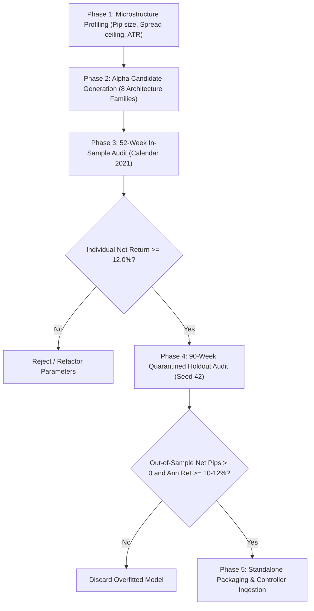

# Standard Operating Procedure (SOP): Quantitative Symbol Alpha Discovery & Dual-Partition Verification

**Version:** 1.0 (Production Institutional Standard)  
**Applicability:** All Quantitative Currency Pairs & Microstructure Fleets (EURUSD, USDJPY, EURGBP, AUDNZD, USDCAD, AUDCAD, NZDCAD, GBPJPY, GBPCHF, EURNZD)  
**Execution Environment:** Authentic Millisecond Dukascopy Tick Engine with Python 3 / NumPy / Pandas / Numba  

---

## 1. Core Principles & Philosophy

To eliminate historical data snooping, curve-fitting, lookahead bias, and portfolio dilution, all strategy candidates across all symbols must adhere to the three foundational pillars of the **Dual-Partition Verification Protocol**:

1. **Strict Individual Standalone Viability**:
   - Every single strategy must achieve **$\ge 12.0\%$ Annual Net Profit on its own allocated capital** ($R \ge 12.0\text{ R}$/year, net pips $\ge 12.0 \times \text{SL}$).
   - **No passengers**: A strategy cannot rely on portfolio diversification to hide negative or sub-hurdle individual returns.

2. **Dual-Partition Temporal Isolation**:
   - **In-Sample Phase (52 Continuous Weeks / Calendar Year 2021)**: Verifies baseline profitability, trade frequency, profit factor, and execution mechanics under dynamic market regimes.
   - **Out-of-Sample Phase (90 Quarantined Holdout Weeks / Seed 42 Deterministic Split)**: Verifies real forward-testing alpha on 126.6+ million untouched Dukascopy ticks. Every model must remain strictly profitable ($> 0\text{ pips}$) with high out-of-sample expectancy ($\ge 10.0\% - 12.0\%$ annualized return).

3. **Institutional Zero-Bias Friction Model**:
   - **0.5 pips round-turn commission** deducted per trade.
   - **0.2 pips adverse entry slippage** penalty applied on market fill.
   - **Dynamic Dukascopy floating spreads** modeled tick by tick (no synthetic fixed spreads).
   - **Strict Causal Discipline**: `.shift(1)` on all indicators derived from higher timeframes (M15, H1, H4, D1). Intra-bar lookahead is strictly prohibited.

---

## 2. Five-Phase Symbol Discovery & Validation Pipeline

When introducing a new symbol or improving an existing symbol fleet, execute the workflow **symbol-by-symbol** sequentially:



### Phase 1: Microstructure Profiling
Identify symbol-specific volatility and liquidity boundaries:
- Pip Size ($0.01$ for JPY pairs, $0.0001$ for all others).
- Dynamic spread ceiling ($2.5$p for majors, $3.0$p for European/Pacific crosses).
- Base Stop Loss boundaries ($6.0\text{p} - 15.0\text{p}$ depending on ATR profile).

### Phase 2: Alpha Candidate Generation
Generate parametric variants across the 8 institutional edge archetypes:
1. **Session VWAP Band Fade** (2.0-SD & 2.5-SD anchored session deviation mean-reversion).
2. **Fibonacci Golden Pocket** (61.8% retracement with H1 36h/48h/72h structural confirmation).
3. **Alexander Elder Triple Screen** (H4 MACD trend + M15 pullbacks).
4. **Daily / Weekly Pivot Wall** (Institutional floor/ceiling bounces).
5. **Keltner Channel Squeeze Explosion** (Bollinger band compression inside Keltner channel).
6. **Opening Range Breakout (ORB)** (London & NY cash open momentum continuation).
7. **Chaikin Volatility Surge** (Microstructure volume/range acceleration).
8. **Parabolic SAR Flip** (Acceleration trail trend capture).

### Phase 3: In-Sample 52-Week Audit
- Evaluate across Weeks 1 to 52 of 2021.
- Calculate: Total Trades ($N$), Net Realized Pips, Return $\% = \text{Net Pips} / \text{SL}$, Profit Factor (PF), Win Rate (WR).
- Gate Filter: **Reject any model with Return $\% < 12.0\%$ or PF $< 1.20$**.

### Phase 4: Quarantined 90-Week Out-of-Sample Holdout Audit
- Ingest quarantined holdout weeks from `data_splits/master_70_30_splits.json`.
- Execute full tick backtest under 0.7p friction.
- Verification Gate:
  * Out-of-Sample Net Pips $> 0.0\text{ pips}$ (strictly profitable).
  * Out-of-Sample Annualized Return $\ge 10.0\% - 12.0\%$.
  * Decay Ratio (OOS Return / IS Return) $\ge 0.40$ (resilient edge continuation).

### Phase 5: Standalone Code Packaging
- Each passing strategy must be wrapped into a standalone Python module with:
  * Inline `_build_bars_internal` (pure NumPy/Pandas resampling).
  * Clean `BaseStrategy` interface.
  * Deterministic signal generation.
  * Class naming convention: `Strategy_<Slot>_<Symbol>_<Name>_Elite`.

---

## 3. Standard CLI Execution Commands

To execute the standard audit battery on any symbol:

```bash
# Execute Full SOP Discovery & Verification on a specific symbol (e.g., USDCAD)
.venv\\Scripts\\python.exe sop/run_symbol_sop_audit.py --symbol USDCAD

# Run 52-Week In-Sample Verification
.venv\\Scripts\\python.exe sop/run_symbol_sop_audit.py --symbol USDCAD --mode in_sample

# Run 90-Week Quarantined Holdout Verification
.venv\\Scripts\\python.exe sop/run_symbol_sop_audit.py --symbol USDCAD --mode holdout
```

